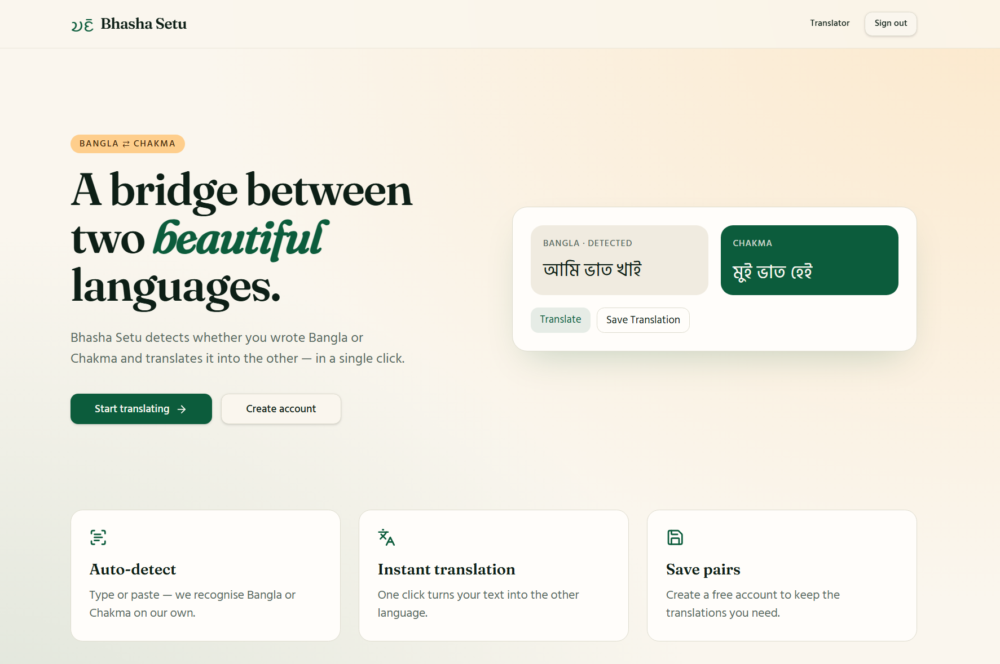
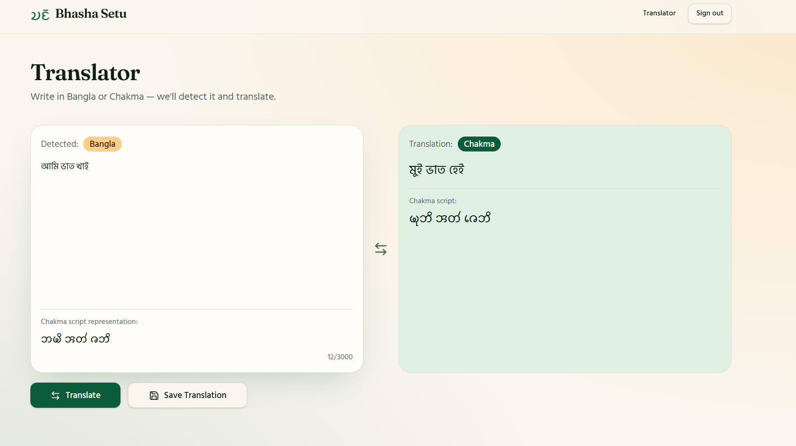
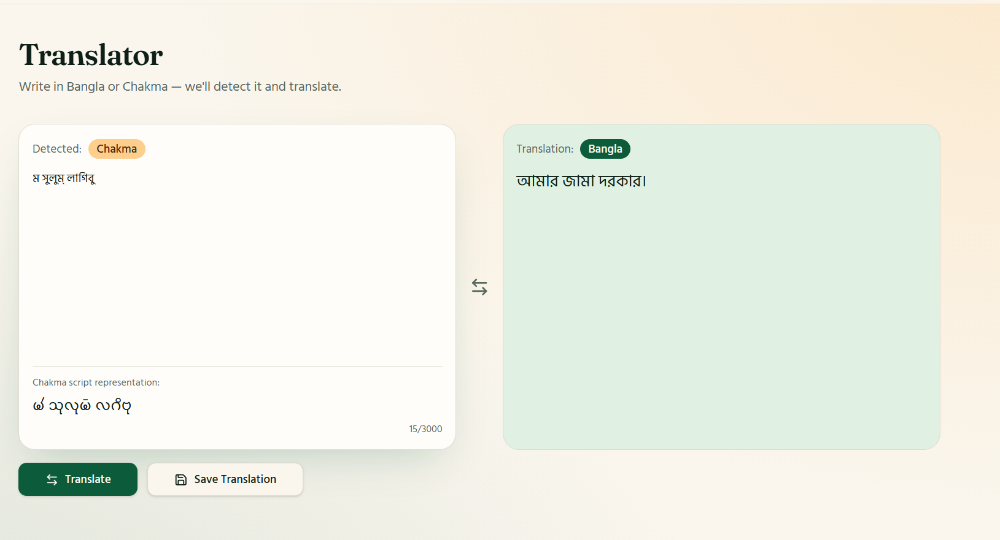
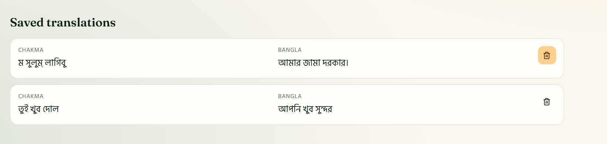

# 𑄌𑄋𑄴 Bhasha Setu —> Bangla-Chakma Translator

Bhasha Setu is a web application and machine-learning project for identifying Bangla or Chakma text and translating between the two languages. It combines a React-based web interface, a FastAPI inference service, locally stored model checkpoints, and notebooks for model development and evaluation.

> **Project status:** The application supports local development. The frontend currently calls the backend at `http://localhost:8000`; deployment requires configuring the backend URL and Supabase for the target environment.

## What it does

- Detects Bangla or Chakma text and displays the detected language.
- Translates Bangla to Chakma and Chakma to Bangla using separate fine-tuned sequence-to-sequence checkpoints.
- Shows script transliterations alongside model output. These transliterations are deterministic character/sign mappings in the frontend; they are distinct from the model-generated translation.
- Provides a responsive landing page, translator, and email/password sign-in and sign-up interface.
- Lets signed-in users save, view, and delete translation pairs using Supabase.
- Includes notebooks for training/evaluation experiments and direct model inference.

## Application architecture

```text
Browser (TanStack Start / React)
  ├─ text entry, detection status, translation, transliteration
  ├─ Supabase Auth and saved_translations
  └─ server functions ── HTTP ──> FastAPI
                                  ├─ /identify
                                  ├─ /translate/ban2chak
                                  └─ /translate/chak2ban
```

### Technology

| Area | Implementation |
|---|---|
| Frontend | React, TypeScript, TanStack Start/Router, Vite, Tailwind CSS |
| Backend API | Python, FastAPI, Pydantic, Uvicorn |
| Language identification | scikit-learn `MultinomialNB` with character n-gram `CountVectorizer` |
| Translation | PyTorch and Hugging Face Transformers `T5ForConditionalGeneration` |
| Accounts and saved text | Supabase Auth and Postgres with row-level security |
| Experiments | Jupyter notebooks; pandas, scikit-learn, Transformers, SacreBLEU and related metrics |

## AI models and methodology

### Language identification

The classifier uses a character-level bag-of-ngrams representation, with n-gram sizes 1–3, followed by a Multinomial Naive Bayes classifier. It returns the predicted language and the largest class probability as a confidence value. The fitted classifier and vectorizer are stored in `Backend/weights/`.

The classification notebook uses a random 80/20 train/test split (`random_state=42`). Its saved output reports **92.72% accuracy**, **96.28% precision**, **89.08% recall**, and **92.54% F1** for Bangla as the positive class. These are notebook-reported results on that split, not a guarantee of performance on new or mixed-language text.

### Translation

The backend loads two local, fine-tuned T5 encoder–decoder checkpoints:

- `Backend/weights/Fine_tuned_BanglaT5` — Bangla to Chakma
- `Backend/weights/Fine_tuned_BanglaT5_CK_BN` — Chakma to Bangla

Each is a `T5ForConditionalGeneration` model. The checked-in configs describe a 12-layer encoder and decoder, 12 attention heads, a 768-dimensional model, and a 2,048-dimensional feed-forward layer. At inference time, the API tokenizes and truncates the input, then generates output with a maximum length of 128 and four-beam search. PyTorch selects CUDA when available and otherwise runs on CPU.

The translation notebook records a Bangla-to-Chakma experiment with 14,667 training examples, 1,833 validation examples, and 1,834 test examples over 15 epochs. Its saved test metrics are **BLEU 23.26**, **ROUGE-L 0.11**, **chrF++ 43.89**, and **TER 64.65**. These are reported notebook outputs and should be interpreted with the dataset, direction, and metric definitions in mind; the repository does not include a human evaluation or comparable reverse-direction benchmark.

## Repository layout

```text
Backend/
  app/                    FastAPI application, endpoints, schemas, inference services
  weights/                Classifier, vectorizer, and translation checkpoints
  requirements.txt
Frontend/
  bangla-chakma-bridge/   TanStack Start web application
notebooks/                Classification, translation, and inference notebooks
FINAL_REPORT.md           Project final report
```

## Setup and run locally

### Requirements

- Python and pip (use a version compatible with the pinned packages in `Backend/requirements.txt`)
- Node.js and npm
- Git
- For account and saved-translation features: a Supabase project with Auth and the `saved_translations` table configured
- The model checkpoints under `Backend/weights/` (included in this repository)

### 1. Start the backend

Run the service from the `Backend` directory because the inference service loads model files using paths relative to that working directory.

```powershell
cd Backend
py -m venv .venv
.\.venv\Scripts\Activate.ps1
python -m pip install --upgrade pip
pip install -r requirements.txt
uvicorn app.main:app --reload
```

The API listens at `http://localhost:8000`. Interactive API documentation is available at `http://localhost:8000/docs`.

Example requests:

```powershell
curl.exe -X POST http://localhost:8000/identify `
  -H "Content-Type: application/json" `
  -d "{\"text\":\"আমি ভাত খাই\"}"

curl.exe -X POST http://localhost:8000/translate/ban2chak `
  -H "Content-Type: application/json" `
  -d "{\"text\":\"আমি ভাত খাই\"}"
```

The other translation endpoint is `POST /translate/chak2ban`. Requests use `{"text":"..."}`; identification returns `text`, `language`, and `confidence`, while translation returns `text`.

### 2. Configure and start the frontend

In a separate terminal:

```powershell
cd Frontend\bangla-chakma-bridge
npm ci
```

Create a local `.env` file in `Frontend/bangla-chakma-bridge/` with the public Supabase project settings:

```dotenv
VITE_SUPABASE_URL=https://YOUR_PROJECT.supabase.co
VITE_SUPABASE_PUBLISHABLE_KEY=YOUR_SUPABASE_PUBLISHABLE_KEY
```

Do not commit credentials or private keys. Apply the SQL in `drizzle/migrations/0000_migration.sql` to the Supabase project to create `public.saved_translations` and its row-level security policies. Configure Supabase Auth providers and redirect URLs before using sign-in; Google sign-in also depends on the Lovable/Supabase OAuth integration.

Then launch the development server:

```powershell
npm run dev
```

Open the local URL printed by Vite. The frontend server functions currently use `http://localhost:8000` as the backend URL in `src/lib/translate.functions.ts`. Keep the API running at that address for local use; update this constant and the backend CORS configuration for another environment.

### Useful frontend commands

Run from `Frontend/bangla-chakma-bridge`:

```powershell
npm test
npm run lint
npm run build
```

### Notebook workflow

Open the notebooks in `notebooks/` with Jupyter or a compatible notebook environment. The classification and training notebooks refer to Kaggle input paths; provide the corresponding datasets and update those paths for a local run. `Bangla_to_Chakma_Model_Test.ipynb` loads the checkpoint at `notebooks/Fine_tuned_BanglaT5`, so run it from the repository root or adjust its model path. Notebook dependencies may differ from the backend's pinned environment.

## Usage instructions

1. Start the backend and frontend as described above.
2. Open the web app and select **Start translating**.
3. Enter or paste Bangla or Chakma text. The app requests automatic language detection as you type.
4. Select **Translate** to show the output in the other language.
5. Sign in to save a translation. Saved pairs appear below the translator and can be deleted.

Review the transliteration shown in the interface as a script representation, not as a second AI translation.

## Screenshots


| Screen | Screenshot |
|---|---|
| *Landing page* |  |
| *Translation of Bangla To Chakma* |  |
| *Translation of with Chakma To Bangla* |  |
| *Saved Translation* |  |

## Notebooks and report

- `notebooks/ostad-capstone-project-classification.ipynb` — character n-gram classification workflow.
- `notebooks/ostad-capstone-project-translation.ipynb` — translation training and metric outputs.
- `notebooks/Bangla_to_Chakma_Model_Test.ipynb` — loading and testing the Bangla-to-Chakma checkpoint.
- [Final project report](FINAL_REPORT.md) — problem, design, AI workflow, results, and conclusions.

## Limitations and next steps

The classifier and translation models are only as reliable as their training data and evaluation coverage. Low-resource language variation, spelling differences, short or mixed-language inputs, and Chakma script rendering can affect results. The displayed benchmark scores come from notebook outputs and do not replace independent or human evaluation. Before deployment, configure a production backend URL, restrict CORS to trusted origins, verify Supabase policies and OAuth settings, and evaluate both translation directions on representative held-out data.
